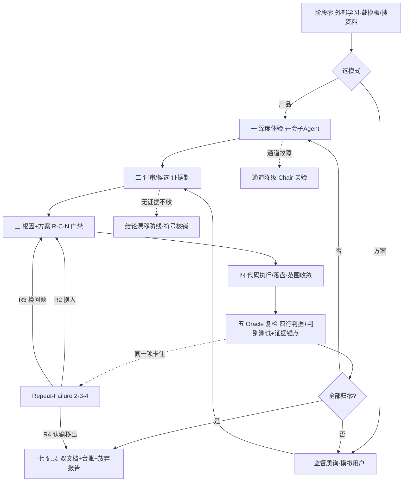

# MaxLoop · 带刹车的 AI 自我迭代引擎


> **English TL;DR** — MaxLoop is a drop-in skill that makes *any* AI agent's self-iteration actually converge, using **external-verification brakes** (Oracle Gate + discriminating tests + evidence anchors) instead of "the model says it's done". Two modes: **product deep-iteration** and **plan-upgrade**. Works with WorkBuddy / Claude Code / Cursor / Codex / OpenCode. MIT.

> **一句话**：一套「带刹车的迭代收敛」通用引擎——让 AI 自我迭代在**有限轮数**里真正收敛，而不是一轮接一轮假绿空转。任何 agent 都能直接加载，不绑定项目、语言或框架。

> v4.0 起，原 `maxloop-overlord`（魔王系统）与 `maxloop-upgrade`（方案升级循环）已**融合为一套思维、两个模式**，本仓库同版本升级。

---

## 30 秒看懂（demo）

```
用户：把登录接口修一下，别再报 SQL 注入
普通循环：✅ 已修复（改用参数化查询）          ← 模型自己说"修好了"
MaxLoop ：Oracle Gate 复检 → 实跑 PoC → 发现 username 字段仍可注入
         判别测试：baseline 旧版必红 + candidate 必绿 → 旧"修复"未过门禁
         → 不出"已修复"结论，继续修到真过测试才放行
```

差别只有一句话：**放行的判据来自模型之外，不来自模型自己。**

---

## 这套 skill 解决什么

- **假绿空转**：传统 AI 自我迭代常「每轮测试都过，问题却还在」，靠模型自己说"修好了"做判据。
- **换马甲返工**：同一缺陷被换层、换说法来回修，烧光轮数预算却没真解决。
- **无证据带偏**：审查/升级结论凭感觉，没有证据的结论把方向带歪。
- **乱加功能 / 主观自辩**：迭代时过度堆功能，或升级校验靠"我觉得对"走过场。

MaxLoop 的全部设计只围绕两句话：**① 放行判据必须来自模型之外；② 只做合理且必要的改动。**

---

## 双模式（同一引擎，适配器不同）

| 维度 | 模式A · 产品深度迭代（原魔王系统） | 模式B · 方案升级循环（原升级循环） |
|---|---|---|
| 对象 | 已到「正式版」的产品 / 代码库 | 模板原档（PPT / 中期汇报 / 需求文档） |
| 目标 | 深度体验 → 评审 → 修复直到问题归零 | 在原档上只合理化升级，不强行加 |
| 触发词 | "深度评审迭代" / "魔王系统收敛" | "maxloop升级方案" / "三轮校验" / "监督agent模拟我" |
| 产出 | 双文档 + 判别测试 + 放弃报告 | 升级方案文档 + 三轮校验台账 |

不是两个 skill，是一套思维两个入口。

---

## 为什么用 MaxLoop（核心价值）

高效提升模型性能只是价值之一，更核心的是下面三项——且都能用**人人懂的指数**衡量：

| 价值 | 一句话 | 人人懂的指数 |
|---|---|---|
| 产出级别更高 | 修一轮是真解决，不是"看着过关" | 产出级别（0–100 分） |
| 产出时间更短 | 同一问题不反复返工，提前收敛 | 产出时间（轮数） |
| 效率明显 | 有限轮数里每轮换来更多真解决 | 效率指数 = 级别 ÷ 轮数 |

### 融合后的净升级（v4.0）

- **overlord 学会"别乱加"**：任何改动先过必要性关（非改不可吗），抑制过度堆功能。
- **upgrade 学会"拿证据说话"**：R/C/N 的正确性必须有真实来源锚点，不再主观自辩；方案升级也有轮数预算与收敛判据。
- 二者都更可信、更省 token、结论更可复核。

---

## MaxLoop vs 普通循环 vs 人工

| 维度 | 普通循环 | 人工评审 | MaxLoop |
|---|---|---|---|
| 放行判据 | 模型自述 | 人主观 | 外部实证 + 逐字符证据锚点 |
| 假绿风险 | 高 | 中 | 低（四件套刹车） |
| 轮数效率 | 低（反复返工） | 慢 | 高（效率指数可量化） |
| 可复核 | 否 | 部分 | 是（双文档 + 台账 + 证据） |
| 适用 | 小修 | 关键发布 | 正式版迭代 / 方案升级 |

---

## 典型请求（怎么触发）

- 模式A："对 XX 做一轮深度评审并迭代修复" / "用魔王系统把这个问题收敛掉" / "有限轮数内把这个模块做扎实"
- 模式B："maxloop 升级方案" / "在 PPT 基础上优化" / "监督 agent 模拟我反复挑刺" / "三轮校验"

## 你需要提供

| 模式A | 模式B |
|---|---|
| 构建/类型检查命令、测试命令、版本发布方式、推送部署命令 | 模板原档（PPT/中期汇报/需求文档）+ 现有研究结论 |

## 产出（每轮交付）

- 双文档留痕 + 台账；每个修复/升级附「修复前失败证据 + 判别测试」；每轮末填**效率指数报告**。

## 边界（不适用）

- 单次小修、纯问答、无明确产物的概念讨论，不需要开 MaxLoop。
- 它管"迭代是否真收敛"，不替你写业务需求。

---

## 安装（你的 agent 都能用）

```bash
# WorkBuddy
git clone https://github.com/huanweide/maxloop-overlord.git ~/.workbuddy/skills/maxloop-overlord

# Claude Code
git clone https://github.com/huanweide/maxloop-overlord.git ~/.claude/skills/maxloop-overlord

# Cursor
git clone https://github.com/huanweide/maxloop-overlord.git ~/.cursor/skills/maxloop-overlord

# Codex / OpenCode
git clone https://github.com/huanweide/maxloop-overlord.git ~/.codex/skills/maxloop-overlord
```

放入对应 `skills` 路径即生效，无需额外配置。任何加载该 skill 的 agent 都可直接调用。

---

## 核心机制（四件套铁链，双模式共用）

```
根因/必要性(R/C/N+A/B) → 确定改什么、改到根上没
判别测试 / 差分探测    → 证明改了有效（改动前必红 / 改动后必绿）
Oracle Gate + 证据锚点  → 禁止自己说改好了（真跑 / lint / 入口可达 / 修复前失败 / 逐字符锚点）
逃逸阶梯 + stall guard  → 卡住时强制换打法（R2 换人 / R3 换问题 / R4 认输）
```

## 主循环状态机



## Chair 每轮执行清单（落地必勾）

任何一项无法勾选 → 不许宣布「项目已无问题」。

| # | 必做项 | 验收证据 |
|---|---|---|
| 0 | 阶段零外部学习已落盘（含「未找到」清单）；模式B 已载模板原档 | `best-practices.md` / 原档已载入 |
| 1 | 每条评审/候选完成核销或 R/C/N 判定，0 命中即废弃 | 核销表或台账 |
| 2 | 每个改动过 R/C/N + 根因段 B | 台账/根因落盘 |
| 3 | 每条修复/升级配判别测试：baseline 旧版必红 + candidate 必绿 | 两份输出都在 |
| 4 | Oracle Gate 全填（a 真跑 / b lint / c 入口可达 / d 修复前失败 / e 证据锚点） | 缺任一行打回 |
| 5 | 同一项累计失败计数，R2/R3/R4 到点强制换打法 | stuck 计数在 |
| 6 | 双文档 + 台账；R4 出结构化放弃报告 | 文件落盘 |
| 7 | 反空转：连续 2 轮全体红点=0 即停 | 不空派 |
| 8 | 效率指数已填 | 指数在记录 |

## 协议清单

**核心四件套**
- `oracle-gate.md` — 外部判据先决（最高铁律）
- `root-cause-protocol.md` — 5 Whys 根因 + 占位符替换测试
- `repeat-failure-breaker.md` — 2-3-4 逃逸阶梯
- `discriminating-test.md` — 判别测试（baseline-fails / candidate-passes）

**模式B 细则**
- `upgrade-mode.md` — 方案升级循环完整细则（模板基准 / 监督 Agent / R/C/N 台账 / 美化用词纪律）

**效果度量**
- `effectiveness-metrics.md` — 效率指数 + 填写模板

**评审与执行**
- `review-protocol.md` · `solution-protocol.md` · `code-exec-protocol.md` · `loop-driver.md` · `degrade-protocol.md` · `record-keeping.md` · `experience-report-template.md` · `novel-forge-adapter.md`

---

## 可视化与实证

- **`efficiency-dashboard.html`**：效率指数对比图，浏览器直接打开即可看。**首份实证（2026-10-25）：同提示词、同模型、同缺陷种子下，MaxLoop 效率指数 ×2.0、假绿率 100%→0%。** 数据与复现见 `experiments/controlled-study-2026-10-25.md`。
- **`experiments/`**：控制变量实证——**同提示词、控变量**测 MaxLoop 对某项任务的工程提升幅度，含复现脚本与原始记录。所有数值均来自真实运行，逐字符可追。

> 我们不靠感觉讲效果。任何"提升 X 倍"的结论，必须能在 `experiments/` 里找到对应的判别测试输出与逐字符证据锚点。

---

## 推广物料（想帮我们涨 star？直接用）

- `promotion/show-hn.md` — Show HN 英文草稿，一键贴 Hacker News
- `promotion/juejin-article.md` — 掘金中文长文草稿，讲透"假绿"与四道刹车
- `promotion/demo-script.md` — 30–60 秒演示录屏脚本（终端 + 验收脚本，开箱即录）
- `SKILL.en.md` — 英文完整方法论文档（英文读者 / 海外 agent 直接读懂，与 `SKILL.md` v4.2 逐条对应）

转载、二创随意，注明出处即可。

---

## 版本

| 版本 | 要点 |
|---|---|
| v2.2 | 初版多智能体迭代，留下「假收敛」教训 |
| v3.0 | 引入四件套刹车（Oracle Gate / 判别测试 / Patch-Depth / Repeat-Failure）+ 证据制评审 |
| v3.1 | 宗旨显性化 + 主循环状态机图 + Chair 执行清单 + 公开发布到 GitHub |
| v3.2 | 通用化 + 效率指数可视化 |
| v3.3 | VulnClaw 四设计内化（证据锚点 / 证据仓 / stall guard / 差分探测） |
| **v4.0** | **融合 maxloop-overlord + maxloop-upgrade 为一套思维双模式；互相补短升级有效性与效果；移除独立 upgrade skill；新增实证目录 `experiments/`** |
| v4.1 | 用户导向校准：焊入「发现真问题 → 轮次修复 → 测试 → 交付真结果」统一脊柱；阶段一强化"发现真问题"、阶段七加"交付小结"、3.5 交付纪律 + Chair#9 专治"倒一大堆"；同轮数实证（MaxLoop 第1轮即真绿，普通轮询第1轮假绿第2轮补对） |
| **v4.2** | **用 MaxLoop 思想净化 MaxLoop 自身（第一性原理逐步行净化，核心四件套不变）；SKILL 瘦身外置版本摘要至 CHANGELOG，七阶段挂脊柱标签①②③④** |

---

## Roadmap

- [ ] 更多 agent 适配示例（Claude Code / Cursor 实战记录）
- [ ] `experiments/` 持续累积跨任务、跨模型的对照数据
- [x] 英文版完整 SKILL 文档（`SKILL.en.md`）
- [ ] 贡献指南（欢迎提交你的实证结果）

欢迎 **Star** 追踪进展，也欢迎在 `experiments/` 提交你的对照实验。

## License

[MIT](LICENSE) © 2026 huanweide
