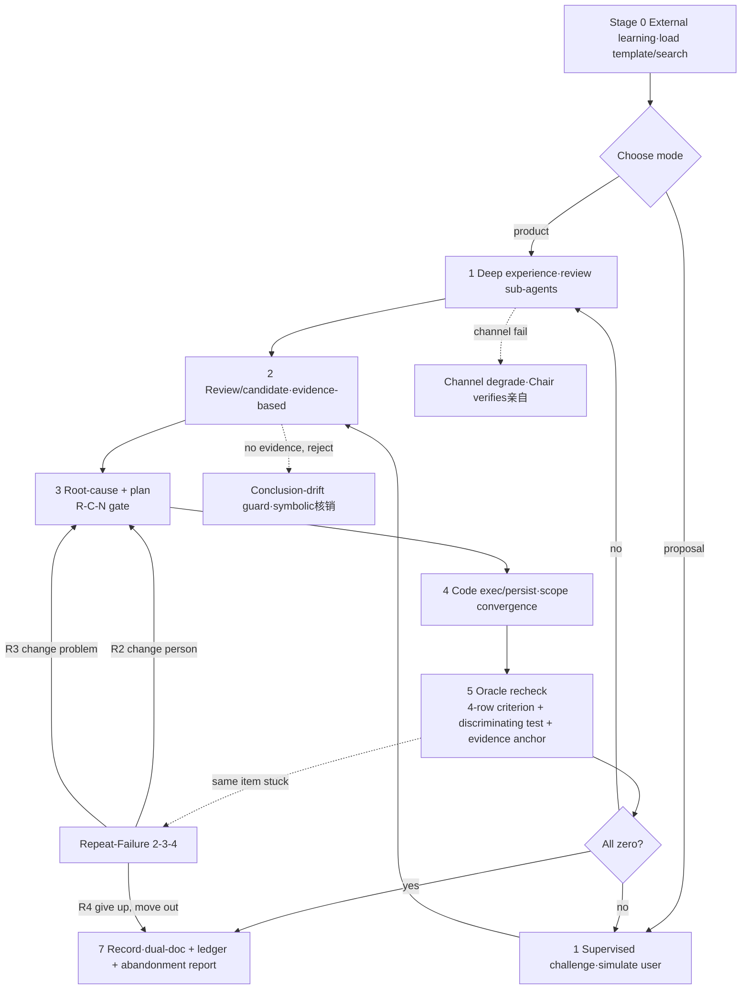

# MaxLoop Unified Iteration Engine v4.2 — A "Braked" Iterative Convergence Discipline (Two Modes)

> This is the English version of [`SKILL.md`](SKILL.md). The skill itself is `SKILL.md` (Chinese); this document exists so English-reading agents and humans can understand the methodology and decide whether to load it. All mechanics below are identical to the canonical Chinese version.

---

## The one-sentence idea

MaxLoop is **not two skills — it is one "braked iterative convergence" discipline**. Whether the target is a "shipping product" or a "proposal / document draft", the underlying loop and brakes are identical; only the domain adapter differs. Two iron laws run through both modes:

1. **The pass criterion must come from outside the model** (external oracle + character-for-character evidence anchor).
2. **Only make reasonable and necessary changes** (necessity gate + mandatory root-cause answer).

---

## 0. Why this exists (read first, or you'll repeat the mistakes)

### 0.1 The two predecessors and their diseases

- **maxloop-overlord (the "Demon King" system)**: strong on external oracles / discriminating tests / Oracle Gate, curing "AI self-iteration false convergence". But it **lacked a "should we even add this?" necessity gate** — it tended to pile on features and patches beyond the actual bug fix, burning rounds on things it shouldn't do.
- **maxloop-upgrade (proposal upgrade loop)**: strong on "only rationalize the upgrade, don't force in features" + three-round R/C/N check. But its R/C/N was **subjective self-justification** ("does the logic hold?" decided by the model itself), with **no external oracle and no efficiency metric** — the check became a formality.

### 0.2 Fusion = mutual补齐 (making both more effective)

| Predecessor gap | Borrowed from the other | Result |
|---|---|---|
| overlord over-adds, no necessity gate | upgrade's "only rationalize / necessity N gate" | every change passes "is it unavoidable?"; add nothing if you can avoid it |
| upgrade R/C/N = subjective self-argue | overlord's "external oracle / evidence anchor / discriminating test" | R/C/N's C (correctness) must have a real source anchor; conclusions become verifiable |
| upgrade has no quantification / stop criterion | overlord's "efficiency index + anti-spin + 2-3-4 escape" | proposal upgrades also get a round budget and convergence criterion; no infinite polishing |
| two割裂 term-sets (review-agent vs supervisor-agent) | unified into one "critic role" | one mental model; no agonizing over "which set to use" |

> In one line: **overlord learned "don't over-add"; upgrade learned "bring evidence, not opinions"** — both become more trustworthy, cheaper in tokens, and more reproducible.

### 0.3 This failure mode has an academic name (why you MUST have an external oracle)

We treated the critic as the oracle. Huang et al., ICLR 2024, *"LLMs Cannot Self-Correct Reasoning Yet"* — **without an external criterion, asking the model to judge "is it fixed?" evaporates the gain**. CRITIC (Gou et al., ICLR 2024) states it most honestly: don't ask the model to self-evaluate; let it **call a tool, and the tool's output is the critic**.

> Honest boundary: not every self-iteration is effective. Xu et al., ICLR 2025 reported mixed results (+8% / −1%). We do **not** claim "the Demon King is always stronger" — we only make the **risk and the brakes explicit**.

### 0.4 The unified spine (calibrated 2026-10-25): Find a real problem → fix it that round → test it → deliver a real result

Regardless of mode A/B, the chain has one spine, and all four links must each be genuinely solid — if any link is hollow, the whole chain collapses:

1. **Find a real problem**: the problem must come from an external criterion / real experience, not the model "feeling something is off", and certainly not fabricated to pad a count. The `critic`'s job is to **converge on real problems**, not spray a pile of nitpicks — listing 20 is worth less than nailing 2 real defects (the kind an external criterion can catch).
2. **Fix it that round**: fix the real problems round by round; every change passes R/C/N + mandatory root cause; no irrelevant padding.
3. **Test**: after fixing, you MUST run the external oracle (Oracle Gate) + discriminating test; **green counts, self-judged "I fixed it" does not**.
4. **Deliver a real result**: deliver the real post-fix state, not a process performance.

**Delivery discipline (cures the "dump a huge pile" disease)**: the final deliverable must be **systematic + plain-spoken**, not a raw dump of the dual-documents / ledger / logs. Hard rules:
- Give a structured summary of "what the real problem was / how it was fixed / how it was proven / current state", not a stream-of-consciousness log;
- Conclusions in plain language, evidence as character-for-character anchors; if one sentence suffices, don't write a paragraph;
- Residual items are explicitly listed as `KNOWN-LIMITATION`, not buried in the body.

---

## 1. Two modes (same engine, different adapter)

| Dimension | Mode A · Product deep-iteration (ex-overlord) | Mode B · Proposal upgrade loop (ex-upgrade) |
|---|---|---|
| Target | A product / codebase that has reached "release" | A template draft (PPT / mid-term report / requirements doc / proposal) |
| Goal | Deep experience → review → fix until problems hit zero | **Only rationalize the upgrade** on the original; don't rebuild, don't force-add |
| Adapter | Code execution + product adapter (build / test / release / push — four commands) | Template baseline + three-round R/C/N check + ledger |
| Triggers | "deep review iteration" / "Demon-King convergence" / "make it solid in limited rounds" | "maxloop upgrade proposal" / "keep optimizing" / "three-round check" / "supervisor agent simulates me" |
| Typical output | Dual-doc + discriminating test + abandonment report | Upgraded proposal doc (per-spot R/C/N) + three-round check ledger |
| When to use | User wants deep iteration on a product | User wants to keep polishing an existing proposal (e.g. a competition project) |

**Non-triggers**: one-off small fix, pure Q&A, concept discussion without a concrete artifact.

---

## 2. The unified main loop (seven stages, shared by both modes)

| Stage | Name (spine link) | Core action in both modes |
|---|---|---|
| **Zero** | **External learning** (prep · not spine) | Before starting, search peers / public material / known pitfalls — **no closed-door invention**; Mode B additionally loads the template draft as baseline |
| One | **① Find a real problem** / supervised challenge (spine ①) | A: spawn review sub-agents to write deep reports, **converge only on externally-falsifiable real defects**; B: supervisor agent (simulates user) continuously searches + challenges, **refuses to fabricate problems to pad count** |
| Two | **② Fix that round** · review/candidate (spine ②) | A: converge the improvement list (evidence-based); B: give candidate changes per gap |
| Three | **② Fix that round** · root-cause + plan / R-C-N (spine ②) | Every change must pass **root-cause section B** + **R/C/N three gates** (see §3) |
| Four | **② Fix that round** · execute / persist (spine ②) | A: edit only within the allowed file set; B: merge the passed delta into the proposal doc |
| Five | **③ Test** · Oracle recheck / evidence verify (spine ③) | Run external oracle + discriminating test; every conclusion needs a **character-for-character evidence anchor** |
| Six | Escape judgment / stall guard (brake · lateral "change tactic") | Repeat-Failure Breaker scoring + consecutive-spin brake; triggers discussion / pivot / degrade |
| Seven | **④ Deliver a real result** · record + delivery summary (spine ④) | Dual-doc + **ledger** + **abandonment report** (if needed) + **systematic plain-spoken delivery summary** (see §0.4) |

### Main-loop state machine (both modes + escape + brakes)

---

## 3. The unified brake system (four shared pieces + shared discipline)

The four pieces form one iron chain: `root-cause / necessity` decides what to change → `discriminating test` proves the change is effective → `Oracle Gate` forbids self-judging "fixed" → `escape ladder / stall guard` laterally manages "when must we change tactic".

### 3.1 External-criterion-first (Oracle Gate) ★ highest + character-for-character evidence anchor

The criterion for "fixed / upgrade effective" **may only come from outside the model**; "reviewer approved / diff looks reasonable / I judge it's fine" are forbidden. Release requires all of:

- (a) The target command **actually executed with output pasted** (not "should pass")
- (b) lint / type-check run on the **changed files**
- (c) **Real entry-point reachability check**: all-green unit tests ≠ the user's actual path is reachable (v2.2's most expensive lesson, cost 3 rounds of无效 rework)
- (d) If claiming a bug fix: give the bug's **pre-fix failure output** (= the discriminating test's baseline FAIL evidence)
- **(e) Character-for-character evidence anchor (hardened v3.3)**: before issuing any `conclusion / flag / vulnerability / factual judgment`, you must be able to find the evidence anchor **character-for-character** in real tool / command / search output; missing anchor = report fails, **no conclusion may be issued**. Directly counters "45% of AI code has OWASP vulnerabilities, and stronger models don't improve safety". Same standard as step 5.5 of the `ai-code-security-audit` skill.

### 3.2 Rationality-Necessity gate (R/C/N fused with Patch-Depth) ★ cures "add blocklist → add scoring → add random features"

Any change proposal missing any of the following may not land:

- **Rationality R**: consistent with project positioning / target scenario / core differentiation? (ex-upgrade R)
- **Correctness C**: are the facts / data / technical basis right? **Has a source AND must have a character-for-character evidence anchor** (fused with overlord's honesty boundary) — if you can't find it, write "not found", don't fabricate. (ex-upgrade C + overlord evidence system)
- **Necessity N**: is it unavoidable? What if we don't change it? Is there a lighter alternative? Does it conflict with differentiation? **Add nothing if you can avoid it.** (ex-upgrade N + overlord scope convergence)
- **Root-cause section B (Patch-Depth)**: `A = failure point (file:line)` + `B = root cause (design / convention layer cause, not symptom)`; if A ≠ B, fix both. Self-check: "if I only fix B, will this problem recur?" Answer "yes" → you haven't found the root cause, rewrite.
  - Counter-example: treating "API returns 500" as the root cause is insufficient; "retry has no backoff, and the error branch returns a faked default value instead of failing loudly" is the real root cause.

> R/C/N and A/B are two faces of the same gate: **R/C/N governs "should we change", A/B governs "did we fix it at the root"**. Neither alone is enough.

### 3.3 Discriminating test / dual-caliber check (runtime_diff_probe)

Any verification claiming "fixed / upgrade effective" must be able to FAIL on the **pre-fix / pre-change** code or draft:

1. Write the test / control → **run it on the old version first, paste the failure output** (baseline-fails)
2. Change code / proposal → run again, paste the pass output (candidate-passes)
3. Both are required; if it passes on the old version too → the verification is **invalid** (locks nothing), rewrite

**Differential-probe warning**: if old-red / new-green, but the green came from **the tested path being skipped / mock replacement / normalized caliber change** rather than a real fix → judge it "false-green", go back to §3.1 to add the character-for-character evidence anchor. The content pipeline (e.g. novel-smith `content-safety.ts`) differential-probe implementation lives in `runtime_diff_probe` (regex banned-words vs runtime tokenizer, same caliber self-check); this engine only consumes its conclusion, doesn't re-implement it.

### 3.4 Escape ladder + stall guard (2-3-4 + consecutive-spin brake)

**Repeat-Failure Breaker (2-3-4 escape ladder)**: attach a `stuck` counter to each item, accumulated across rounds:

| Cumulative failures | Stage | Forced action | Forbidden |
|---|---|---|---|
| 1 | Normal path | Fix A + B + pass R/C/N | — |
| 2 | ★ Discuss (change person) | Stop writing code; run 5 Whys; change the responsible role (change model / identity card); write "Why did both attempts fail" | No directly editing the same thing a third time |
| 3 | ★ Pivot (change problem) | Force-rewrite the problem statement itself; search for alternatives first (change hand / model / abstraction layer) | No reusing the same phrasing |
| 4 | ★ Degrade (change front) | Hand in a structured Abandonment Report, mark KNOWN-LIMITATION and move it out of the list, move to the next optimization point | No silent retry |

**stall guard (consecutive-spin detection, fusing No-Progress Guard + anti-spin)**: record three signal classes — repeated calls (same `(tool, arg, error)` triple recurs), failure degradation (channel degrade / patch rejected), timeout (single step over budget). **N (default 2)** consecutive same-class spins → trigger brake → **force human / upper-layer intervention**, forbid infinite retry burning tokens. stall guard manages the micro "every step identical" spin; 2-3-4 manages the macro "same item stuck" escape; the former responds first, the latter is the backstop.

**Abandonment Report template**: paths tried (each with failure evidence) / each failure's reproducible output / current best solution / why it's unsuitable to keep iterating / suggested next human step. No silent exit, no infinite retry.

### 3.5 Shared discipline (both modes obey)

- **Honesty boundary / no hallucination**: all findings based on real evidence; if not found, write "not found", never fill a number.
- **Dual-doc trail → AgentState evidence store**: every tool output / search / intermediate conclusion is uniformly persisted with an `evidence_id`; review uses `evidence_search/view` for precise recall, not dumping everything into context (cures long-task context bloat).
- **Batch orchestration (anti-overload)**: review / execution agents ≤5 per batch; next batch only after the current batch fully returns.
- **Channel degrade & self-heal**: when a sub-agent channel fails, always verify after dispatch (non-empty + persisted); 2 consecutive failures → degrade to Chair亲自-verify, no stall, no fake output.
- **Highest execution authority**: no need to ask before judging "no problems left"; keep driving until auto-stop; but bound by the escape ladder and anti-spin double constraint, no forcing rounds just to pad count.
- **Deliver plain-spoken, not a huge pile (2026-10-25 calibration)**: every deliverable (dual-doc / ledger / report) must end with a "systematic summary" — real-problem list (with evidence anchors) + fix actions + current real state + KNOWN-LIMITATION; forbid dumping raw logs, per-round thinking, and intermediate diffs未经提炼 directly onto the user.

---

## 4. Mode A specifics (product deep-iteration)

- **Roles**: review sub-agent (read-only diagnosis, must be truly spawned; non-overlapping lenses, actionable; Web/desktop real screenshots + button clicks, CLI/lib downgraded to command chains + boundary tests, **forbid faking screenshots for non-UI projects**) / Chair (summarize, dispatch, verify亲自, final decision) / code-exec agent (may only edit "this round's allowed file set").
- **Product adapter**: user provides four things — build / type-check command, test command, version release method, push/deploy command.
- **Stage-zero external learning**: search GitHub peers item-by-item against "what are we missing" + target-platform public material, produce `PROCESS/research-<topic>/best-practices.md` (including a "not found" list).
- **Review becomes "evidence-based"**: votes → evidence strength; a single vote listing a P1 must attach a character-for-character evidence anchor; no evidence → observation pool.
- **Efficiency index (shared metric)**: output level (0–100, real-solved-and-verified problems ÷ all) × output time (rounds) ÷ = efficiency index. Fill 3 numbers per round into the meeting record (template: `references/effectiveness-metrics.md` and repo-root `efficiency-dashboard.html`).
- **Protocol refs**: `references/oracle-gate.md` / `root-cause-protocol.md` / `repeat-failure-breaker.md` / `discriminating-test.md` / `review-protocol.md` / `solution-protocol.md` / `code-exec-protocol.md` / `loop-driver.md` / `degrade-protocol.md` / `record-keeping.md` / `experience-report-template.md` / `novel-forge-adapter.md`.

---

## 5. Mode B specifics (proposal upgrade loop)

> Full details in `references/upgrade-mode.md`; key points here.

- **Baseline = template draft**: the original PPT / mid-term report / requirements doc is the only baseline. All upgrades go on top of it — **no rebuild, no overturning the original structure, no forced additions**.
- **Supervisor agent (simulates user) = unified critic role**: played by one sub-agent — strongly critical, engineering-minded, demands sources, allergic to forced features, demands "plain speech". It **continuously searches for new evidence** + challenges candidate changes ("why change? what's the basis? can we skip it? does it conflict with differentiation?").
- **Three-round check gate (lands on §3.2 R/C/N)**: every "add / modify / decide" passes R/C/N line-by-line before persisting; any gate failing → reject or degrade, forbid persist. Record each R/C/N conclusion + pass/reject/degrade reason line-by-line.
- **Output**: ① upgraded proposal doc (per-section upgrade points + R/C/N judgment + source on the original structure); ② three-round check ledger (table: change item | R | C | N | conclusion | basis).
- **Beautification & wording discipline (PPT deliverables only)**: beautification = layout / color / readability / projection clarity, not stuffing new arguments; wording = clarify and tighten existing content, not inventing new facts. **Red lines**: forbid punchlines / slogans / self-aggrandizement / unverified adjectives; if the original draft has no conclusion, leave it blank rather than invent. Three-round check applies equally to every beautification / wording change.
- **Don't stop**: loop forward, each round producing an inheritable upgrade delta; can attach a recurring automation to run continuously until the user stops or there's nothing left to upgrade.
- **Example**: candidate "cut ToF" → R: radar UART already contains self-consistent distance logic; C: LD2410C data frame confirmed to contain detection distance (cm), source datasheet; N: saves one I2C line + one sensor + cost → **pass**. Candidate "add temp/humidity sensor" → R: irrelevant to focus / companionship positioning; N: forced add unnecessary → **reject**.

---

## 6. Unified roles (critic role)

- **Unified naming**: Mode B's "supervisor agent (simulates user)" ≡ Mode A's "review sub-agent / reviewer" ≡ **unified critic role**. It only produces **evidence-backed** conclusions; Chair verifies亲自 and summarizes. No more maintaining two term-sets.
- **Main agent (Chair)**: executes the upgrade / iteration, answers critic challenges, passes gates, persists, maintains the ledger; makes the final decision on reported items, verifies diffs + gates亲自.

---

## 7. Termination condition (auto-stop, shared)

All simultaneously true:
1. All sub-agents / critics this round have reported (if batched, all batches present).
2. All reported problems resolved (residual = 0), including items explicitly handed off as KNOWN-LIMITATION.
3. Improvement / upgrade list is zero (every item passed Oracle Gate + discriminating test + R/C/N).
4. Efficiency index is filled.

If not satisfied, continue — but **bound by the Repeat-Failure Breaker and stall guard double constraint**: no forcing rounds just to pad count.

---

## 8. Chair per-round execution checklist (must tick to land)

| # | Required | Protocol | Evidence |
|---|---|---|---|
| 0 | Stage-zero external learning persisted (incl. "not found" list); Mode B loaded template draft | SKILL stage zero | `best-practices.md` exists / draft loaded |
| 1 | Each review/candidate completed symbolic/line核销 or R/C/N judgment before entering list; 0-hit abandoned | review-protocol §5 / upgrade-mode |核销 table or ledger present |
| 2 | Each change passes R/C/N + root-cause section B (A failure point + B root cause, fix both if A≠B) | SKILL 3.2 | judgment in ledger / root cause persisted |
| 3 | Each fix/upgrade has discriminating test: baseline old-version-fails + candidate-passes | discriminating-test | both outputs present |
| 4 | Oracle Gate fully filled (a real-run / b lint / c entry-reachable / d pre-fix-fail / e evidence-anchor) | oracle-gate | missing any row → reject |
| 5 | Same-item cumulative failure count; R2/R3/R4 force tactic change at threshold | repeat-failure-breaker | stuck count present |
| 6 | Dual-doc + ledger trail; R4 produces structured abandonment report | record-keeping / upgrade-mode | files persisted |
| 7 | Anti-spin: 2 consecutive rounds with zero red points → stop, no round-padding | SKILL 3.4 | no empty dispatch |
| 8 | Efficiency index filled (output level / output time / efficiency index) | effectiveness-metrics | index in record |
| 9 | Delivery summary systematic & plain: real-problem list (anchors) + fix + state + KNOWN-LIMITATION, no raw log dump | SKILL 0.4 / 3.5 | summary at end of deliverable |

---

## 9. Resources

### Core four-piece set (both modes share the same brakes; `references/` has the deep detail)
- `references/oracle-gate.md` — **external-criterion-first clause** (highest iron law, incl. §3.1 four rows + e evidence anchor)
- `references/root-cause-protocol.md` — **5 Whys root cause** + placeholder-replacement test (distinguish real root cause vs patch)
- `references/repeat-failure-breaker.md` — **2-3-4 escape ladder**
- `references/discriminating-test.md` — **discriminating test** (baseline-fails / candidate-passes)

> Four-piece serial: `root-cause` decides what to change → `discriminating-test` proves effective → `oracle-gate` forbids self-judge → `repeat-failure-breaker` manages tactic change.

### Mode B details (new in v4.0)
- `references/upgrade-mode.md` — full proposal-upgrade-loop details: template baseline, supervisor agent, R/C/N ledger, beautification/wording discipline, examples

### Carried from v2.2 / v3.x
- `references/experience-report-template.md` · `review-protocol.md` · `solution-protocol.md` · `code-exec-protocol.md` · `loop-driver.md` · `degrade-protocol.md` · `record-keeping.md` · `novel-forge-adapter.md` · `effectiveness-metrics.md`

---

## 10. Version history (externalized)

The **operating rules** of this skill are exactly the above: unified spine (§0.4) + unified main loop (§2) + unified brake system (§3) + roles (§6) + per-round checklist (§8) + mode adapters (§4/§5). Version **evolution and the motivation for each change are externalized to `CHANGELOG.md`** — the operating doc only says "how to use", the history says "why this way", two layers separated, avoiding the operating doc degenerating into "a huge pile" of history (exactly what the §0.4 delivery discipline demands: systematic plain speech, not a dump).

- Current version: frontmatter `version: 4.2`
- Full change history (v2.2 → v4.2, with per-change motivation): → `CHANGELOG.md`
- Deep HOW (detailed protocols for each brake): → `references/`
