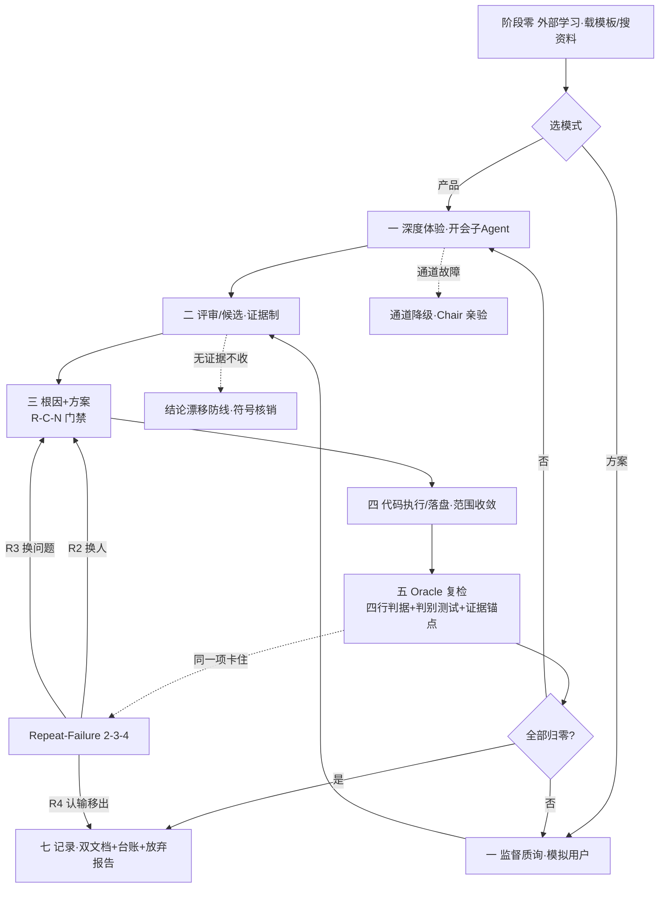

# MaxLoop 统一迭代引擎 v4.2 · 一套带刹车的迭代收敛思维（双模式）

> **统一思维（一句话）**：MaxLoop 不是两个 skill，是**一套「带刹车的迭代收敛」思维**——无论对象是「正式版产品」还是「方案/文档原档」，底层循环与刹车完全一致，只有领域适配器不同。两条铁律贯穿双模式：**① 放行判据必须来自模型之外（外部判据 + 逐字符证据锚点）；② 只做合理且必要的改动（必要性闸门 + 必答根因）。**

## 零、为什么融合成一套（先读，否则会重蹈覆辙）

### 0.1 两个前身各自的病

- **原 maxloop-overlord（魔王系统）**：强在外部判据 / 判别测试 / Oracle Gate，治「AI 自我迭代假收敛」。但它**缺「该不该加」的必要性关**——容易在「修 bug」之外过度堆功能、加补丁，烧轮数做不该做的事。
- **原 maxloop-upgrade（方案升级循环）**：强在「只合理化升级、不强行加功能」、三轮校验（R/C/N）。但它的 R/C/N **偏主观自辩**（"逻辑站得住吗"靠模型自己判断），**无外部判据、无效率度量**，校验容易变成走过场。

### 0.2 融合后互相补短（这就是「升级二者的效果和有效性」）

| 前身短板 | 从对方获得的补足 | 升级后的效果 |
|---|---|---|
| overlord 易过度堆功能、缺必要性关 | upgrade 的「只合理化 / 必要性 N 关」 | 任何改动先过「非改不可吗」；能不加就不加，抑制范围膨胀 |
| upgrade 的 R/C/N 靠主观自辩 | overlord 的「外部判据 / 逐字符证据锚点 / 判别测试」 | R/C/N 的 C（正确性）必须有真实来源锚点，结论可核验，不再是"我觉得对" |
| upgrade 无量化、无终止判据 | overlord 的「效率指数 + 反空转 + 2-3-4 逃逸」 | 方案升级也有轮数预算与收敛判据，不无限润色 |
| 两套术语割裂（开会子Agent vs 监督Agent） | 统一为「critic 角色」 | 一套心智模型，不会纠结"该用哪套" |

> 一句话：**overlord 学会"别乱加"，upgrade 学会"拿证据说话"**——二者都更可信、更省 token、结论更可复核。

### 0.3 失败模式有学术名字（为什么必须有外部判据）

我们把 critic 当成了 oracle。Huang et al., ICLR 2024《LLMs Cannot Self-Correct Reasoning Yet》——**没有外部判据时让模型自判"修好了没"，收益蒸发**。CRITIC（Gou et al., ICLR 2024）立场最诚实：不要求模型自评，让它**调工具，工具输出才是 critic**。

> 诚实边界：并非所有自我迭代都有效。Xu et al. ICLR 2025 报告过 +8% / −1% 的混合结果——我们不宣称「魔王系统一定更强」，只是把**风险与刹车显式化**。

### 0.4 统一导向（2026-10-25 用户校准）：发现真问题 → 轮次修复 → 测试 → 交付真结果

无论模式A/B，整条链只有一条脊柱，四个环节**每个都要真过硬**——任何一环虚了，整条链就废：

1. **发现真问题**：问题必须来自外部判据 / 真实体验，不是模型「感觉不对」，更不是为凑数硬找。`critic` 的职责是**收敛到真问题**，不是铺一堆 nitpick——列 20 条不如钉死 2 条真缺陷（外部判据抓得出来的那种）。
2. **轮次修复**：针对真问题一轮轮修，每条改动过 R/C/N + 必答根因，不做无关堆砌。
3. **测试**：修完必须跑外部判据（Oracle Gate）+ 判别测试，**绿了才算数**，不准自判「改好了」。
4. **交付真结果**：交付的是**解决真问题后的真实状态**，不是过程表演。

**交付纪律（专治「一大堆」顽疾）**：最终交付必须**体系化 + 说人话**，不是把双文档 / 台账 / 日志原样倾倒。硬要求：
- 给一张「真问题是什么 / 怎么修的 / 怎么证的 / 现在状态」的结构化小结，而非流水账；
- 结论用大白话，证据用逐字符锚点，能一句话说清就不写一段；
- 残留项显式列为 `KNOWN-LIMITATION`，不淹没在正文里。

---

## 一、双模式定位（同一引擎，适配器不同）

| 维度 | 模式A · 产品深度迭代（原魔王系统） | 模式B · 方案升级循环（原升级循环） |
|---|---|---|
| 对象 | 已到「正式版」的产品 / 代码库 | 模板原档（PPT / 中期汇报 / 需求文档 / 方案） |
| 目标 | 深度体验 → 评审 → 修复，直到问题归零 | 在原档上**只合理化升级**，不另起炉灶、不强行加 |
| 适配器 | 代码执行 + 产品适配层（构建/测试/发布/推送四命令） | 模板基准 + 三轮校验 R/C/N + 台账 |
| 触发词 | "深度评审迭代" / "魔王系统收敛" / "有限轮数做扎实" | "maxloop升级方案" / "不断优化" / "三轮校验" / "监督agent模拟我" |
| 典型产出 | 双文档 + 判别测试 + 放弃报告 | 升级方案文档（逐处标 R/C/N）+ 三轮校验台账 |
| 何时用 | 用户要对产品做深度迭代 | 用户要在原方案上持续打磨（如竞赛项目） |

**非触发**：单次小修、纯问答、无明确产物的概念讨论。

---

## 二、统一主循环（七阶段，双模式共用）

| 阶段 | 名称（脊柱环节） | 双模式核心动作 |
|---|---|---|
| **零** | **外部学习**（前置·非脊柱） | 开工前先搜同类/公开资料/已知坑，**不许闭门造车**；模式B 额外载入模板原档作为基准 |
| 一 | **① 发现真问题** / 监督质询（脊柱①） | A：派开会子 Agent 写深度报告，**只收敛到外部判据可证伪的真缺陷**；B：监督 Agent（模拟用户）持续搜索 + 提出质询，**拒绝为凑数硬找问题** |
| 二 | **② 轮次修复** · 评审/候选（脊柱②） | A：收敛改进清单（证据制）；B：对每个 gap 给候选改动 |
| 三 | **② 轮次修复** · 根因+方案/R-C-N（脊柱②） | 每条改动必须过**根因段 B** + **R/C/N 三关**（见第三节） |
| 四 | **② 轮次修复** · 执行/落盘（脊柱②） | A：限定可改文件集合内改码；B：把过关 delta 合入方案文档 |
| 五 | **③ 测试** · Oracle 复检/证据校验（脊柱③） | 跑外部判据 + 判别测试；每条结论须有**逐字符证据锚点** |
| 六 | 逃逸判定 / stall guard（刹车·横向管换打法） | Repeat-Failure Breaker 计分 + 连续空转刹车，触发则讨论/pivot/降级 |
| 七 | **④ 交付真结果** · 记录+交付小结（脊柱④） | 双文档 + **台账** + **放弃报告**（如需）+ **体系化说人话的交付小结**（见 0.4 交付纪律） |

### 主循环状态机图（双模式 + 逃逸 + 刹车）

> 看图说话：阶段零先定模式与基准；阶段五复检发现新坑回到阶段一；同一项卡住走右侧逃逸阶梯；评审无证据走结论漂移防线；体验通道故障走降级。

---

## 三、统一刹车系统（双模式共用四件套 + 共享纪律）

四件套串成一条铁链：`根因/必要性` 定改什么 → `判别测试` 证改动有效 → `Oracle Gate` 禁止自判修好 → `逃逸阶梯/stall guard` 横向管"什么时候必须换打法"。

### 3.1 外部判据先决（Oracle Gate）★ 最高 + 逐字符证据锚点

「修好了 / 升级有效」的判据**只允许来自模型之外**，禁止以「reviewer 认可 / diff 看着合理 / 我自己判断」为准。放行须同时具备：

- (a) 目标命令**真实执行并贴输出**（不是"应该能过"）
- (b) lint/类型检查在**改动文件**上跑过
- (c) **真实入口可达性验证**：单元测试全绿 ≠ 用户实际路径可达（这是 v2.2 最贵教训，贡献 3 轮无效返工）
- (d) 若声称修复某 bug：给出该 bug **修复前的失败输出**（= 判别测试的 baseline FAIL 证据）
- **(e) 逐字符证据锚点（v3.3 硬化）**：任何 `结论 / flag / 漏洞 / 事实判定` 出具前，必须能**逐字符**在真实工具/命令/检索输出里找到证据锚点；锚点缺失 = 报告未通过，**不得出结论**。直接对冲「45% AI 代码含 OWASP 漏洞、模型越强安全表现不改善」。与 `ai-code-security-audit` SKILL 第 5.5 步同口径。

### 3.2 合理-必要闸门（R/C/N 融合 Patch-Depth）★ 专治「加黑名单→加打分→乱加功能」

任何改动提案，缺以下任一项不许落地：

- **合理性 R（Rationality）**：与项目定位 / 目标场景 / 核心差异化一致吗？（原 upgrade R）
- **正确性 C（Correctness）**：事实 / 数据 / 技术依据对吗？**有来源且须逐字符证据锚点**（融合 overlord 诚实边界）——查不到写"查不到"，不编。（原 upgrade C + overlord 证据制）
- **必要性 N（Necessity）**：非改不可吗？不改会怎样？有没有更轻替代？是否和差异化冲突？**能不加就不加**（原 upgrade N + overlord 范围收敛）
- **根因段 B（Patch-Depth）**：`A 段 = 出错点（文件:行号）` + `B 段 = 根因（设计/约定层成因，非现象）`；A ≠ B 则两者同修。自检句：「只修 B，这问题还会再出现吗？」答「会」→ 没找到根因，重写。
  - 反面例子：把「API 返 500」当根因不够；「重试没退避，且错误分支返回伪造默认值而非大声失败」才是。

> R/C/N 与 A/B 是同一闸门的两面：**R/C/N 管"该不该改"，A/B 管"改到根上没"**。二者缺一不可。

### 3.3 判别测试 / 双口径校验（runtime_diff_probe）

任何声称「修好了 / 升级有效」的验证，必须能在**修复前 / 改动前**的代码或原档上失败：

1. 写测试/对照 → **先跑到旧版上，贴出失败输出**（baseline-fails）
2. 改代码/方案 → 再跑，贴出通过输出（candidate-passes）
3. 二者缺一不可；若旧版上也通过 → 该验证**无效**（没锁住任何东西），重写

**差分探测扩展告警**：若旧红新绿，但绿是因为**被测路径被跳过 / mock 替换 / 归一化口径变了**而非真修复 → 判为「假绿」，回 3.1 补逐字符证据锚点。内容管线（如 novel-smith `content-safety.ts`）的差分探测实现见 `runtime_diff_probe`（正则 banned-words 与运行时分词同口径自检），本引擎只消费其结论、不重复实现。

### 3.4 逃逸阶梯 + stall guard（2-3-4 + 连续空转刹车）

**Repeat-Failure Breaker（2-3-4 逃逸阶梯）**：给每个条目挂 `stuck` 计数器，跨轮累加：

| 累计失败 | 阶段 | 强制动作 | 禁止 |
|---|---|---|---|
| 1 | 正常路径 | 修 A + B + 过 R/C/N | — |
| 2 | ★讨论（换人） | 停写代码；跑 5 Whys；换主责角色（换模型/身份卡）；写《为什么两次都没成功》 | 不许直接改同名第三遍 |
| 3 | ★Pivot（换问题） | 强制改写问题陈述本身；先搜索找替代方案（换手/换模型/换抽象层） | 不许沿用同一表述 |
| 4 | ★降级（换战线） | 交结构化《放弃报告》，标 KNOWN-LIMITATION 移出清单，转下一优化点 | 不许静默重试 |

**stall guard（连续空转检测，整合 No-Progress Guard + 反空转）**：记录三类信号——重复调用（同一 `(工具,参数,错误)` 三元组重现）、失败降级（通道降级/补丁被打回）、超时（单步超预算）。连续 **N 次（默认 2）** 同类空转 → 触发刹车 → **强制人工/上层介入**，禁止无限重试烧 token。stall guard 管「每一步都一样」的微观空转，2-3-4 管「同一项卡住」的宏观逃逸；前者先响、后者兜底。

**《放弃报告》模板**：试过的路径（每条附失败证据）/ 每次失败可复现输出 / 当前最佳解 / 为什么不适合继续迭代 / 建议人类下一步。不许静默退出，也不许无限重试。

### 3.5 共享纪律（双模式都守）

- **诚实边界 / 禁止幻觉**：所有发现须基于真实证据；查不到写「未找到」，绝不填数。
- **双文档留痕 → AgentState 证据仓**：每条工具输出/检索/中间结论统一落库带 `evidence_id`，评审经 `evidence_search/view` 精确回查，不全塞上下文（治长任务上下文膨胀）。
- **批次编排（防过载）**：开会/执行 Agent 单批 ≤5，本批全返回才派下批。
- **通道降级与故障自愈**：子代理通道失效时派发后必校验（非空+落盘），连续 2 次失败即降级为 Chair 亲验，不卡死、不假装产出。
- **最高执行权限**：判定「已无问题」前无需请示，持续驱动直至自动停止；但受逃逸阶梯与反空转双重约束，不为凑轮数硬派。
- **交付说人话、不一大堆（2026-10-25 校准）**：所有交付物（双文档 / 台账 / 报告）末尾必须附「体系化小结」——真问题清单（带证据锚点）+ 修复动作 + 当前真实状态 + KNOWN-LIMITATION；禁止把原始日志、逐轮思考、中间 diff 不经提炼直接倾倒给用户。

---

## 四、模式A 专属（产品深度迭代）

- **角色**：开会子 Agent（只读诊断，必须真实 spawn，透镜不重叠且可行动；Web/桌面真截图+点按钮，CLI/库降为命令链路+边界测试，**禁止给无 UI 项目硬造假截图**）/ Chair（汇总、派发、亲验、最终决策）/ 代码执行 Agent（只能改「本次允许改动的文件集合」）。
- **产品适配层**：用户提供四项——构建/类型检查命令、测试命令、版本发布方式、推送部署命令。
- **阶段零外部学习**：搜 GitHub 同类实现逐项对照「我们缺什么」+ 目标平台公开资料，产出 `PROCESS/research-<topic>/best-practices.md`（含「未找到」清单）。
- **评审改「证据制」**：票数→证据强度，单票即列 P1 须附逐字符证据锚点；无证据进观察池。
- **效率指数（双模式共用度量）**：产出级别（0–100，真解决且验证过的问题÷全部）× 产出时间（轮数）÷ = 效率指数。每轮末填 3 数落会议记录（模板见 `references/effectiveness-metrics.md` 与仓库根 `efficiency-dashboard.html`）。
- **协议引用**：`references/oracle-gate.md` / `root-cause-protocol.md` / `repeat-failure-breaker.md` / `discriminating-test.md` / `review-protocol.md` / `solution-protocol.md` / `code-exec-protocol.md` / `loop-driver.md` / `degrade-protocol.md` / `record-keeping.md` / `experience-report-template.md` / `novel-forge-adapter.md`。

---

## 五、模式B 专属（方案升级循环）

> 详细细则见 `references/upgrade-mode.md`，此处给要点。

- **基准 = 模板原档**：原始 PPT / 中期汇报 / 需求文档是唯一基准。所有升级都在其上加，**不另起炉灶、不推翻原结构、不强行加东西**。
- **监督 Agent（模拟用户）= 统一 critic 角色**：由一个子 Agent 扮演——批判性强、工程思维、要求来源、反感强行加功能、要求"讲人话"。它**持续搜索新证据** + 对候选改动提出质询（"为什么改？依据呢？不加行不行？会不会和差异化冲突？"）。
- **三轮校验门禁（落 third 节 3.2 的 R/C/N）**：每个"添加/修改/抉择"落盘前逐条过 R/C/N，任何一关不过 → 打回或降级，禁止落盘。逐条记录 R/C/N 结论 + 过关/打回/降级理由。
- **输出物**：① 方案升级文档（原档结构基础上逐节标注升级点 + R/C/N 判定 + 来源）；② 三轮校验台账（表格：改动项 | R | C | N | 结论 | 依据）。
- **美化与用词纪律（PPT 交付物专用）**：美化=版式/配色/可读性/投影清晰度，不是塞新论点；用词=把已有内容讲清讲精炼，不是发明新事实。**红线**：禁止金句/口号/自我拔高/未核实形容词；原档没有的结论宁可留白也不编。三轮校验同样适用于每条美化/用词改动。
- **不要停止**：循环推进，每轮产出可继承的升级 delta；可接 recurring automation 持续运行，直到用户喊停或无可升级项。
- **示例**：候选"砍掉 ToF" → R：雷达 UART 已含距离逻辑自洽；C：LD2410C 数据帧确认含检测距离(cm)，来源 datasheet；N：省一路 I2C+一颗传感器+成本 → **过关**。候选"加温湿度传感器" → R：与专注/陪伴定位无关；N：强行加无必要 → **打回**。

---

## 六、角色统一（critic 角色）

- **统一命名**：模式B 的「监督 Agent（模拟用户）」≡ 模式A 的「开会子 Agent / 评审员」≡ **统一 critic 角色**。它只产出**带证据**的结论，Chair 亲验后汇总。不再维护两套术语。
- **主 Agent（Chair）**：执行升级/迭代、答 critic 质询、过门禁、落盘、维护台账；对汇报事项做最终决策、亲验 diff + 门禁。

---

## 七、终止条件（自动停止，双模式共用）

同时满足：
1. 本轮所有子 Agent / critic 汇报完毕（分批则所有批次齐活）。
2. 各报告问题全部解决（残留 = 0），含 KNOWN-LIMITATION 已显式交接的条目。
3. 改进/升级清单归零（每条都过了 Oracle Gate + 判别测试 + R/C/N）。
4. 效率指数已填。

未满足则继续，但**受 Repeat-Failure Breaker 与 stall guard 双重约束**：不为凑轮数硬派。

---

## 八、Chair 每轮执行清单（落地必勾）

| # | 必做项 | 对应协议 | 验收证据 |
|---|---|---|---|
| 0 | 阶段零外部学习已落盘（含「未找到」清单）；模式B 已载模板原档 | SKILL 阶段零 | `best-practices.md` 存在 / 原档已载入 |
| 1 | 每条评审/候选入清单前完成符号/行号核销或 R/C/N 判定，0 命中即废弃 | review-protocol §5 / upgrade-mode | 核销表或台账在 |
| 2 | 每个改动过 R/C/N + 根因段 B（A 出错点 + B 根因，A≠B 同修） | SKILL 3.2 | 判定在台账/根因落盘 |
| 3 | 每条修复/升级配判别测试：baseline 旧版必红 + candidate 必绿 | discriminating-test | 两份输出都在 |
| 4 | Oracle Gate 全填（a 真跑 / b lint / c 入口可达 / d 修复前失败 / e 证据锚点） | oracle-gate | 缺任一行打回 |
| 5 | 同一项累计失败计数，R2/R3/R4 到点强制换打法 | repeat-failure-breaker | stuck 计数在 |
| 6 | 双文档 + 台账留痕；R4 出结构化放弃报告 | record-keeping / upgrade-mode | 文件落盘 |
| 7 | 反空转：连续 2 轮全体红点=0 即停，不凑轮数 | SKILL 3.4 | 不空派 |
| 8 | 效率指数已填（产出级别 / 产出时间 / 效率指数） | effectiveness-metrics | 指数在记录 |
| 9 | 交付小结体系化说人话：真问题清单(锚点)+修复+状态+KNOWN-LIMITATION，无原始日志倾倒 | SKILL 0.4 / 3.5 | 小结在交付物末尾 |

---

## 九、Resources

### 核心四件套（模式A/B 共用同一刹车；references/ 为深度细节）
- `references/oracle-gate.md` — **外部判据先决条款**（最高铁律，含 3.1 四行+a 证据锚点）
- `references/root-cause-protocol.md` — **5 Whys 根因** + 占位符替换测试（区分真根因 vs 补丁）
- `references/repeat-failure-breaker.md` — **2-3-4 逃逸阶梯**
- `references/discriminating-test.md` — **判别测试**（baseline-fails / candidate-passes）

> 四件套串行：`root-cause` 定改哪 → `discriminating-test` 证有效 → `oracle-gate` 禁自判 → `repeat-failure-breaker` 管换打法。

### 模式B 细则（v4.0 新增）
- `references/upgrade-mode.md` — 方案升级循环完整细则：模板基准、监督 Agent、R/C/N 台账、美化用词纪律、示例

### 沿用 v2.2 / v3.x
- `references/experience-report-template.md` · `review-protocol.md` · `solution-protocol.md` · `code-exec-protocol.md` · `loop-driver.md` · `degrade-protocol.md` · `record-keeping.md` · `novel-forge-adapter.md` · `effectiveness-metrics.md`

---

## 十、版本历史（已外置）

本 skill 的**运行规则**就是上文：统一导向（0.4 脊柱）+ 统一主循环（二）+ 统一刹车系统（三）+ 角色（六）+ 每轮清单（八）+ 模式适配器（四/五）。版本**演进与每条改动的动机已外置到 `CHANGELOG.md`**——运行文档只讲"怎么用"，历史讲"为什么这么改"，两层分离，避免运营文档退化成「一大堆」历史（这正是 0.4 交付纪律要求的：体系化说人话，而非倾倒）。

- 当前版本：见 frontmatter `version: 4.2`
- 完整变更史（v2.2 → v4.2，含每条动机）：→ `CHANGELOG.md`
- 深度 HOW（各刹车的详细协议）：→ `references/`
